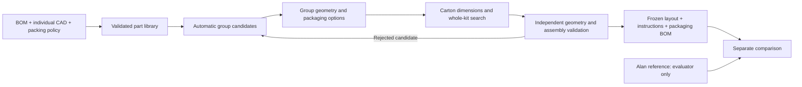

# From-scratch packaging: audit and implementation proposal

Date: 2026-11-06. Audited implementation: `27f8dc0`.
Status: research and proposed design; the replacement pipeline is not implemented.

## Conclusion

The repository contains useful search, validation and reporting components, but
does not yet satisfy the requested independent BOM/CAD-to-packaging workflow.
The complete 101/102 results are adapted recipes. They demonstrate declared
geometric fit at Alan's external volumes, not autonomous packaging design.
The earlier completion claim was incorrect for this requirement.

Keep the geometry and verification core. Add a generic hierarchical optimizer
that chooses groups, protective packaging and carton dimensions together.
Alan's solution must enter only the evaluator, after a candidate is frozen.

## What the code actually does

| Component | Verified behavior | Missing capability |
| --- | --- | --- |
| `src/bom2kit/solver.py` | Searches rectangular units in a supplied cavity using layers and extreme coordinates; independently validates the result | Does not invent groups or carton sizes; `seed` does not diversify search |
| `src/bom2kit/optimization.py` | Tries a supplied carton catalogue and preserves specified protection | No automatic dimension generation; currently uses reference volume to filter candidates |
| `src/bom2kit/mesh_search.py` | Unseeded voxel/beam search exists for a fixed cavity; triangle checks validate retained poses | No complete packaging hierarchy; 24 axis rotations relative to an optional orientation hint; soft timeout |
| `src/bom2kit/mesh_packing.py` | Searches two-part nesting proposals | Not a mixed-kit packaging designer |
| `mesh_validation.py`, `bom.py` | Check source hashes, rigid transforms, containment, collision/clearance and declared BOM coverage | Do not establish accuracy of estimated dimensions or real packet contents |
| `mesh_motion.py` | Checks straight vertical group insertion through reverse removal; binds certificates to sources | Does not establish support, hand access or required clearance throughout motion |
| `assessment.py` | Combines declared BOM coverage, static geometry and reference volume | Its `computational_acceptance` does not certify independent design, packing order or transport equivalence |
| Kit-specific scripts | Assemble and verify prepared recipes, render actual geometry | Not a reproducible clean-input design pipeline |

Concrete dependencies on prepared solutions:

- `scripts/assemble_101_kit.py`: reads a previously generated merged-box job,
  loads five subgroup layouts and supplies explicit outer positions in `specs`.
- `scripts/repack_101_custom_clamps.py`: loads the historical four-clamp layout
  and supplies PSU/cord positions and a fixed BOX3 cavity.
- `scripts/assemble_102_complete.py`: loads prepared subgroups, places them at
  explicit coordinates, sets the inner carton to 362 x 276 x 170 mm and the
  reference exterior to 376 x 290 x 184 mm.
- `scripts/write_102_arm_recipe.py`: modifies an existing 68 mm pair spacing
  to 65 mm. This is recipe adaptation, not independent pose discovery.

The existing suite was rerun: **82 tests passed in 9.54 seconds**. Synthetic
tests demonstrate real unseeded search in small fixed cavities. They do not
demonstrate autonomous complete-kit design for 101/102. The reported 7.23/8.87 s
complete-kit measurements are fresh assessment times, not cold design times.

## Why the previous approach missed the task

The acceptance gate checked fit at a known target, rather than independence of
the design process. Prepared groups and hand-selected coordinates became part
of the pipeline. Static and motion validation then made those recipes credible,
but could not establish how they had been discovered.

The 102 result also replaced upper cartons with film and reduced ten servo
sleeves to 1 mm. These changes were disclosed, but equal volume under changed
protection is not proof of equivalent packaging quality. Equal volume is only
one comparison dimension.

## Required input and output

**Input:** authoritative BOM and revisions; individual CAD; measured purchased
item envelopes or explicitly authorized estimates; assembly states; grouping
rules; fragility/contact/orientation constraints; permitted materials and minimum
protection; manufacturing increments and size limits. BOM alone usually lacks
enough geometry and protection information.

Preserve user corrections: custom clamp frame **106 mm**, external inner-box
dimensions where source evidence says so, 1.5 mm cardboard for that reference,
bagged bearings allowed, disassembled ArUco. A material rule may be reused;
Alan's box dimensions, grouping and placements may not be search inputs.

**Output:** chosen outer dimensions; inner box/bag/divider dimensions; packaging
BOM; every part's rigid pose and group; executable assembly order; numbered
illustrated instructions; assumptions, tolerances, validation and runtime.
For manufactured cartons, generate a supported parametric blank/drawing with
material thickness, folds, tabs and allowances. Unsupported styles must be
reported as dimension specifications, not production-ready dielines.

## Recommended architecture

### 1. Geometry with a compact text index

Keep full CAD/meshes in the geometry engine. Generate JSON summaries containing
SKU, revision, quantity, hashes, bounds, volume, allowed orientations, material,
contact restrictions and uncertainty. Automatically derive candidate frames
from oriented bounds and large faces; retain alternatives for ambiguous shapes.
Remove source assembly/print-plate translations from the packing coordinate frame.

This is the useful role of **CAD-to-text**: describing and indexing geometry.
Text dimensions cannot preserve concavities or prove nesting. The language model
interprets requirements; numerical tools calculate poses and validate them.

### 2. Generate groups without reference layouts

Start with singleton parts and functional labels from the BOM. Propose compatible
pairs and small clusters using shape complementarity, repeated-part symmetry,
handling constraints and projected volume savings. Bound the number of proposals;
do not enumerate every partition of the kit.

Search each cluster using coarse voxel proposals, then refine promising poses
against original triangles. Include collision-free assembly paths before retaining
a cluster. Store several nondominated shapes, not only the smallest volume:
a slightly larger flat group may produce a smaller outer carton.

Required grouping constraints are hard; convenience preferences are penalties.
Do not silently split a required assembly or combine incompatible parts.

### 3. Design packaging and the outer carton together

For each group, enumerate permitted protection options: carton, divider, sleeve,
bag or tray. Add actual wall, seam, fold and handling allowances to its envelope.
Protection minima are fixed input rules, not variables that may shrink to make
a candidate pass. Flexible cables use finite approved packed-state alternatives;
equal packet volume alone does not justify an arbitrary new aspect ratio.

Build an initial feasible layout using conservative envelopes; this gives an
independent upper bound. Generate candidate outer dimensions from group spans,
layer heights and manufacturing increments. Use volume and individual-dimension
lower bounds to prune, not Alan's volume. Include several aspect ratios or an
independently supplied supplier catalogue. Account for outer walls and cushioning
exactly once.

Search across group choices, orientations, insertion order and carton dimensions.
Use a fast constructive layout followed by bounded destroy-and-repair moves:
remove a few groups, split/merge a cluster, change a layer or carton dimension,
then repack. Retain the best fully validated complete solution throughout.
Failed bounded search means unresolved, not impossible.

Rank candidates lexicographically: hard constraints and complete coverage first,
then external shipping volume, then packaging complexity/material and handling
steps. Record the trade-offs; do not hide missing contents behind a score.

### 4. Validate and generate instructions from one artifact

Reuse the existing hash, BOM and triangle validators. Add a policy validator,
manufacturing/tolerance checks and generic internal cluster assembly verification.
Default to straightforward top insertion; allow workbench preassembly only with
an explicit verified sequence. Reject unresolved support or handling constraints
when the policy requires them. Current straight-path tests alone are insufficient.

All drawings and instructions must derive from the same frozen layout. Publish
separate statuses for geometry, BOM, policy, assembly, design independence and
physical qualification. Physical shipping performance still requires a trial;
computational success must not imply that trial happened.

## Technology choice

| Candidate | Appropriate role | Decision |
| --- | --- | --- |
| Existing Python search + Trimesh/FCL | Irregular group proposals, original-triangle checks and motion validation | Reuse; profile before rewriting |
| PackingSolver `box` | Fast rectangular group/outer-box candidate packing | Evaluate as an optional backend against the existing solver |
| PackingSolver `irregular` | Two-dimensional contour/layer proposals | Optional; its documented irregular solver is 2D, not arbitrary 3D nesting |
| OR-Tools | Discrete group/packaging-option selection or a custom constrained model | Not a drop-in mesh packing engine; the official bin-packing example uses scalar capacity |
| LLM-generated coordinates or reinforcement learning | Unverified layout guesses or a new training project | Do not make either the first implementation path |

PackingSolver currently documents Python >=3.12; this repository uses 3.11.
Benchmark a pinned CLI or isolated environment before adding it as a dependency.
The proposed hybrid is an engineering recommendation, not a measured superiority
claim. No new backend was installed or benchmarked during this audit.

Primary sources reviewed on 2026-11-06:

- [PackingSolver: problem types, objectives and installation](https://github.com/fontanf/packingsolver).
- [Trimesh collision API](https://trimesh.org/trimesh.collision.html).
- [FCL: collision, distance and continuous collision](https://github.com/flexible-collision-library/fcl).
- [OR-Tools bin-packing example](https://developers.google.com/optimization/pack/bin_packing).

## Speed and cost: proposed targets, not results

Measure cold import/preparation, search, validation and report generation separately
on a recorded machine. Initial targets for these kits: first complete candidate
within 60 seconds after preparation; improvement budget 5 minutes; full cold run
within 10 minutes; unchanged-recipe recheck within 30 seconds. Benchmark before
promising any of these numbers. A candidate within 60 seconds need not match Alan.

Cache geometry by source hash, orientation, tolerances and tool versions. Cache
independently generated group alternatives by full policy and membership hashes.
Use cheap bounds first and triangle checks for shortlisted candidates. Apply a
global deadline and reserve time for final validation; worker processes may be
needed to enforce it around expensive native operations.

The skill should launch a bounded engine job and read compact progress/results.
Do not use repeated model turns to invent coordinates or run one-off repair scripts.
CPU search time and subscription-token consumption are separate budgets; this
research does not establish a percentage of the user's subscription needed.

## Implementation sequence and acceptance gates

1. **Separate inputs and evaluation.** Create neutral 101/102 manifests from
   BOM/CAD and explicit policy. Strip reference dimensions, box names, group poses,
   orientation hints derived from Alan and dependencies on old output directories.
   Keep raw evidence separately; audit each field's provenance.
2. **Deliver one clean design command.** Proposed interface:
   `bom2kit design BOM.json --parts parts.json --policy policy.json --budget 300`.
   Implement automatic frames, group proposals, packaging alternatives and carton
   generation. It must run after deleting every generated layout/recipe.
3. **Integrate validation and local improvement.** Handle assembly and protection
   failures as search feedback. Generate packaging specifications and instructions
   from the selected result, without manual coordinate edits.
4. **Run independent comparisons.** Freeze candidate hashes before the evaluator
   reads Alan's reference. Compare complete contents and the same protection policy.
   Use the same algorithm/configuration for both kits; record all runs and failures.
5. **Demonstrate transfer.** Change quantities, rename/reorder items and change a
   part revision; verify fresh design or explicit failure. Test an unseen kit before
   claiming general-purpose performance.

The independent-design runner should use an isolated input directory and an
allowlist of readable sources, with no access to previous results or references.
Cache-disabled runs and deliberately invalid reference files must not change
design results for the same configuration. Inspect code for SKU-specific geometry
branches as well: filesystem isolation cannot detect hard-coded answers.

The team has already seen 101/102 references. Therefore those kits can demonstrate
reference-free execution, but are not genuinely unseen tests. An additional held-out
kit is needed for evidence of generalization.

Final gate: complete 101 and 102 contents, validated geometry and assembly,
unchanged declared protection requirements, independently chosen packaging,
external volume no larger than the comparable Alan reference, measured runtime,
and reproducible diagrams. If comparable baseline protection or contents remain
unknown, report that comparison as conditional. No readiness flag or unit-test
count may substitute for this gate. Until it passes, the original task is open.
