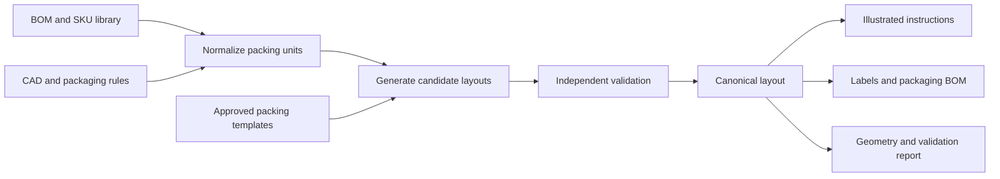

# BOM-to-Kit Implementation Plan

Status: proposed; implementation has not started.

Research date: 2026-11-06.

## Objective

Build a reusable skill for Codex and Claude Code that converts a bill of materials into a compact, organized, reproducible packing plan and illustrated kitting instructions.

The skill will orchestrate deterministic geometry and packing tools. The language model will interpret requirements and explain results; numerical placement, quantity accounting, and geometric validation will run in code.

The initial target is a local workflow for robot kits with dozens of packing units. Arbitrary industrial packaging design and transport qualification are outside the first release.

## Evidence and limitations

- The reviewed SO-ARM101 reference specifies a 364 × 290 × 184 mm outer carton, equivalent to 19.423 L. Its EPE drawing specifies a 320 × 246 × 140 mm usable cavity, equivalent to 11.021 L. External shipping volume and usable packing volume must remain separate metrics.
- The reference uses nested parts, inner boxes, and layered outer packing. Independent bounding boxes for every part will lose useful nesting opportunities.
- The available instructions disagree about BOX4 contents and the assembly state of the ArUco set. Resolve these differences before creating a benchmark or issuing new production instructions.
- Seven downloaded STEP models were read successfully with CadQuery. A single local diagnostic run took 18.638 seconds overall: 17.010 seconds to import the library and approximately 1.628 seconds to read the models and calculate axis-aligned bounds, volumes, and solid counts.
- This diagnostic did not optimize packing, validate a complete kit, or establish production performance. The STEP files were in a `Deprecated` directory and are not automatically approved production inputs.
- The reported 50 L language-model result has not been inspected. Its BOM, protection requirements, dimensions, and assembly state must match the engineer's reference before comparing volumes.

## Architecture

Use a common command-line engine behind both agent integrations. Start with local execution and pinned dependencies; introduce a service or MCP interface only if remote execution becomes necessary.

### Responsibilities

| Component | Responsibility |
| --- | --- |
| Skill | Discover inputs, resolve missing requirements, invoke tools, interpret verified results |
| Ingestion | Normalize BOM quantities, variants, revisions, units, and source provenance |
| Geometry | Read CAD, prepare candidate orientations and conservative proxies, cache results |
| Solver | Generate and improve candidate layouts within a time budget |
| Validator | Independently check quantities, containment, clearances, collisions, and placement constraints |
| Renderer | Generate views, labels, and instructions from the validated layout |

### Initial technology candidates

| Tool | Intended use | Limitation or decision gate |
| --- | --- | --- |
| CadQuery / OpenCascade | STEP import, geometry preparation, CAD export | Validate units, assembly structure, and revision mapping; a solid is not necessarily a SKU |
| Trimesh | Mesh proxies, oriented bounds, collision queries | Pin and verify optional collision dependencies; mesh quality and tolerances affect results |
| PackingSolver `box` | Rectangular packing units and inner boxes | Does not solve arbitrary concave 3D nesting |
| PackingSolver `irregular` | Layer-based placement of 2D contours | A 2D solution still needs height, support, and 3D validation |
| Template library and local search | Reuse engineer-approved arrangements and adapt changed groups | Templates must be invalidated or revalidated after relevant geometry or rule changes |

The currently documented PackingSolver Python distribution requires Python 3.12 or later; the inspected local Python runtime is 3.11. Select a compatible pinned environment or use the solver CLI during the dependency spike.

Keep `skjolber/3d-bin-container-packing` as an alternative rectangular solver. Evaluate PackAssistant only through a representative mixed-kit demonstration: its documented emphasis is packing identical parts, and API access and licensing require separate verification.

## Input and output contracts

### Required input information

The user may supply only a BOM when the SKU library already contains the remaining information. Missing geometry or packing-state data must be reported rather than invented.

Each SKU or packing unit needs:

- Stable identifier, quantity, variant, revision, and source reference.
- CAD geometry or measured dimensions of its actual packed state.
- Explicit units and measurement uncertainty.
- Measured or supplier-provided mass where weight constraints apply.
- Allowed orientations, support requirements, fragile regions, clearances, and protective materials.
- Grouping constraints and permitted nesting relationships.
- State: loose component, assembled unit, sealed packet, or original factory box.

Cables require an approved coiled or bagged envelope. Fasteners require a packet definition. A servo that must remain sealed is represented by its factory box, not its bare motor geometry.

Represent assembly transitions explicitly. For example, an ArUco body and six panels can become one assembled unit at a defined workflow stage without losing component-level accountability.

### Canonical artifacts

| Artifact | Contents |
| --- | --- |
| `normalized-bom.json` | Components, quantities, variants, revisions, and assembly transitions |
| `geometry-index.json` | File hashes, units, geometry references, candidate orientations, and provenance |
| `packing-rules.json` | Protection, grouping, container, orientation, and operational constraints |
| `layout.json` | Instance IDs, parent containers, coordinates, rotations, and packing sequence |
| `validation.json` | Checks performed, failures, tolerances, unresolved assumptions, and validation status |
| `packaging-bom.json` | Cartons, inserts, bags, separators, labels, and quantities |
| Instruction PDF or HTML | Step-by-step views, part identifiers, counts, and final checks |

Images, counts, labels, and prose must use the same validated layout and BOM revision. The language model must not independently change numerical facts during document generation.

## Delivery phases

### Phase 0 — Establish a trustworthy reference

1. Select one product configuration and freeze its BOM revision and packing state.
2. Resolve conflicting source instructions with the responsible engineer.
3. Obtain current CAD for nonstandard parts and measured envelopes for purchased or bagged items.
4. Record internal and external carton dimensions, EPE geometry, tolerances, and protective materials.
5. Capture the engineer's arrangement and its provenance, ideally including part transforms.
6. Obtain the reported 50 L result and normalize its assumptions for comparison.

Deliverable: an approved reference manifest, a missing-data report, and a benchmark specification.

Exit criterion: the reference is complete enough to check counts and geometry. Unresolved production assumptions remain explicit and prevent an approved production release.

### Phase 1 — Validate the geometry toolchain

1. Create a pinned local environment and confirm operation on the target Windows workstation.
2. Import STEP and mesh samples, preserving instance identity and units.
3. Calculate axis-aligned and oriented bounds, simplified meshes, and layer contours where appropriate.
4. Cache derived geometry by source hash, processing settings, and relevant rules.
5. Verify optional collision dependencies and headless rendering.
6. Measure cold startup, warm processing, and failure behavior on representative files.

Deliverable: geometry extraction and inspection capability with machine-readable output.

Exit criterion: dimensions agree with approved source measurements within declared tolerances; invalid or ambiguous inputs produce actionable errors.

### Phase 2 — Reproduce the reference and build the validator

1. Encode the approved engineer arrangement as a layout and reusable templates.
2. Check quantities by component identity and assembly stage.
3. Independently check containment, collisions, clearances, permitted orientations, and support.
4. Check the required insertion path for each unit; a collision-free final pose alone is insufficient.
5. Recalculate external volume, usable volume, and mass without conflating them.
6. Exercise deliberate faults: omitted and duplicated parts, wrong units, impossible clearances, blocked insertion, stale geometry, and double-counted assemblies.

Deliverable: an independently validated reference and negative test fixtures.

Exit criterion: the validator accepts the agreed reference and rejects representative incorrect layouts. Any approximation or unimplemented check is visible in the result status.

### Phase 3 — Implement bounded packing search

1. Generate several candidate groupings and inner-box dimensions.
2. Use rectangular packing for factory boxes, packets, and outer-box composition.
3. Use contour-based placement for suitable layers of irregular parts.
4. Reuse approved pairs and small-group arrangements for nested parts.
5. Add local search over orders, orientations, and group assignments.
6. Apply detailed mesh or CAD validation to promising candidates.
7. Return the best verified candidates when the time budget expires.

Keep multiple inner-box candidates: the smallest individual box may produce a worse outer arrangement. Restrict reflections and rotations according to physical part identity and packing rules.

Deliverable: a small set of feasible layouts with explicit trade-offs in external volume, material use, and packing operations.

Exit criterion: all released candidates pass the independent validator. A timeout is reported as an incomplete search, not proof of infeasibility or optimality.

### Phase 4 — Generate operational instructions

1. Render top, side, isometric, and exploded views from the validated scene.
2. Generate one packing sequence with stable part and box identifiers.
3. Derive all counts and checklists from the canonical BOM and assembly transitions.
4. Include protection placement, orientation cues, packet labels, and final closure steps.
5. Generate packaging material quantities and dimensions.
6. Inspect rendered documents for readability and consistency.
7. Have an operator pack one physical kit using only the generated instructions; record deviations and completion time.

Deliverable: an instruction package tied to a specific BOM, geometry, rules, and layout revision.

Exit criterion: the physical trial is reproducible, and any changes made during the trial are reflected in the canonical data and regenerated documents.

### Phase 5 — Package the skill for both agents

1. Write a shared `SKILL.md` with input discovery, missing-data handling, tool invocation, validation, and output requirements.
2. Expose stable CLI commands for ingestion, geometry, solving, validation, and rendering.
3. Add only the schemas, references, and templates needed by the workflow.
4. Package the same core for Codex under `.agents/skills/` and Claude Code under `.claude/skills/`, without manually maintaining divergent copies.
5. Document installation and dependency checks in English.
6. Test both agents on complete inputs, missing geometry, conflicting revisions, a timeout, and a small BOM change.

Deliverable: equivalent agent integrations around one tested engine.

Exit criterion: both agents produce traceable results and clearly distinguish preliminary layouts, geometrically validated layouts, and physically checked packaging.

## Evaluation plan

Compare four approaches using the same frozen inputs:

| Approach | Purpose |
| --- | --- |
| Independent bounding boxes | Establish a simple baseline |
| Oriented bounds and hierarchical grouping | Measure benefits of rotations and grouping |
| Contours, detailed geometry, and nesting search | Measure benefits of shape-aware placement |
| Approved templates and local adaptation | Measure operational speed for recurring kits |

Keep search-from-scratch and template-adaptation benchmarks separate. An engineer's reference layout must not silently become input to a supposedly independent search test.

Measure external carton volume, count accuracy, validated constraint violations, processing time, operator packing time, and packing errors. Run repeated trials and distinguish cold startup from warm-cache execution.

Provisional acceptance targets, to be confirmed on the frozen reference:

- Complete and correct component accounting.
- No violations of implemented geometric and operational constraints.
- External volume within 10% of the approximately 20 L engineer reference under equivalent assumptions.
- A repeated similar kit within one minute with a prepared library.
- A new layout within one to five minutes with prepared geometry.
- A separate deeper-search mode with a five-to-fifteen-minute budget.

These are engineering targets, not measured capabilities. Geometric validity does not establish transport durability; material selection and physical transport testing remain separate requirements.

## Repository and data policy

- All documentation, commit messages, and pull request text are written in English.
- Commit messages follow Conventional Commits, for example `docs: add BOM-to-kit implementation plan`.
- Keep executable code, schemas, synthetic tests, and skill definitions under version control when implementation starts.
- Keep downloaded business inputs in `packaging-inputs/` and generated or downloaded packaging artifacts in `packaging-results/`; both directories are ignored.
- Do not silently promote deprecated CAD or generated instructions to approved production sources.
- Record source hashes and revisions so a result can be reproduced without committing private artifacts.

## Research references

- [CadQuery import and export](https://cadquery.readthedocs.io/en/latest/importexport.html)
- [OpenCascade bounding boxes](https://occt3d.com/dev/doc/refman/html/class_b_rep_bnd_lib.html)
- [Trimesh bounds](https://trimesh.org/trimesh.bounds.html)
- [Trimesh collision queries](https://trimesh.org/trimesh.collision.html)
- [PackingSolver repository](https://github.com/fontanf/packingsolver)
- [PackingSolver 3D box solver](https://fontanf.github.io/packingsolver/box.html)
- [PackingSolver 2D irregular solver](https://fontanf.github.io/packingsolver/irregular.html)
- [Alternative rectangular packing solver](https://github.com/skjolber/3d-bin-container-packing)
- [PackAssistant capabilities](https://www.packassistant.de/en/product.html)
- [PackAssistant downloads and API documentation listing](https://www.packassistant.de/de/download.html)
- [Research on physically realizable packing of general 3D shapes](https://arxiv.org/abs/2212.02094)
- [Codex skill documentation](https://learn.chatgpt.com/docs/build-skills)
- [Claude Code skill documentation](https://code.claude.com/docs/en/skills)
- [SO-ARM101 packing design task](https://redmine.fosterflow.com/issues/9415)
- [SO-ARM102 packaging instruction task](https://redmine.fosterflow.com/issues/9391)
- [SO-ARM102 packaging contents task](https://redmine.fosterflow.com/issues/9108)
